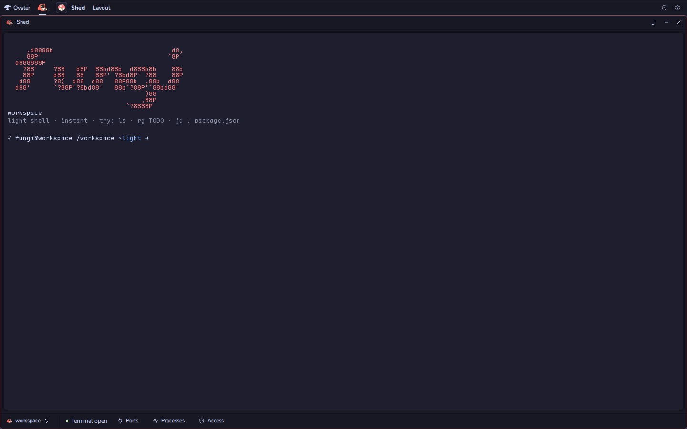
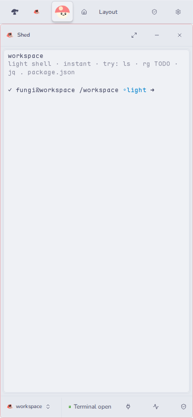

# Shed (`@fungi.computer/shed`)

Shed opens a terminal on your Computer, with its open ports and running
processes one click away.



Shed is one of the starter Apps of
[Oyster](https://github.com/fungi-computer/oyster), the open App host that runs
on your own Cloudflare account. On Oyster, the Computer is a Linux workspace in
a Cloudflare Container; Shed runs commands there, not on your laptop.

## What you can do

- Type commands at an instant light prompt (`ls`, `rg TODO`, `jq . package.json`
  and the like). A command that needs a real Linux process, such as `npm`,
  `node` or an interactive program, opens the full terminal in its place.
- Search and recall your last 500 prompt commands while Shed is open.
- Open **Processes** to see what is running, what has exited and what is
  uncertain, and stop a running process.
- Open **Ports**, expose the port your dev server listens on, and preview it
  beside the terminal.
- Open **Access** to see which Computer permissions Shed holds.

The Computer is always there as a durable workspace. Its container may be
stopped; running a command starts it again. Processes end when the container
stops and do not come back when it starts. Closing Shed does not stop a process.



## Get it

Shed installs with the other starter Apps. On a deployed Oyster (see the
[Oyster quick start](https://github.com/fungi-computer/oyster#quick-start-deploy-your-own-oyster)),
run:

```sh
export OYSTER_URL=https://oyster.<your-subdomain>.workers.dev
export OYSTER_OWNER_KEY=<your owner key>
npx oyster install-apps
```

The installer clones this repository and the six others, seeds each on your
Oyster with `git push`, builds them on your Computer and installs them. Sign in
at `$OYSTER_URL/login` with the owner key and open Shed from the Tourtois
desktop. Run `install-apps` again to update; each App keeps its data.

Port previews open on a second origin that never carries your sign-in. Oyster
turns them on when its host sets `OYSTER_PREVIEW_ORIGIN`; without it, **Ports**
still exposes and removes ports and says that previews are off.

## Change it

Every installed App is also a template you can fork on your own Oyster. Fork
Shed into a Bonsai repository and clone it with ordinary `git`:

```sh
curl -X POST -H "Authorization: Bearer $OYSTER_OWNER_KEY" -H 'content-type: application/json' \
  -d '{"appId":"app_shed","name":"my-shed"}' \
  $OYSTER_URL/apps/bonsai/methods/apps.fork
git -c http.extraHeader="Authorization: Bearer $OYSTER_OWNER_KEY" \
  clone $OYSTER_URL/git/bonsai/my-shed.git
```

The reply names your fork's App id and repository. Push your edits, open the
repository in Bonsai and choose **Settings**, then **Build & install** with that
App id and your commit as `git:<sha>`. Install the Release at `shed` to replace
the running Shed, or at a new id to keep both.

To work from GitHub instead, fork this repository and point the installer at
your forks with `--repositories <base URL>` and `--ref <branch or tag>`. The
installer reads all seven starter Apps from that base, so fork them under one
account.

## Agent tools

Agents call Shed through Oyster's MCP endpoint, or at
`POST $OYSTER_URL/apps/shed/methods/<name>` with a key; see
[Git, keys and MCP](https://github.com/fungi-computer/oyster#git-keys-and-mcp).

| Method                                    | What it does                                                                                                                                                                                                                                                                   |
| ----------------------------------------- | ------------------------------------------------------------------------------------------------------------------------------------------------------------------------------------------------------------------------------------------------------------------------------ |
| `runCommand({command, cwd?, timeoutMs?})` | Runs a shell command for up to 45 seconds. Returns `stdout`, `stderr`, `exitCode`, `stdoutTruncated` and `stderrTruncated` (64 KiB per stream), or `{ error: code }`. A budget refusal also supplies `kind` and `retryAfterMs`. Workflow Git commands use `$FUNGI_GIT_REMOTE`. |
| `listProcesses({})`                       | Lists up to 64 processes on the Computer. Starts nothing.                                                                                                                                                                                                                      |
| `listPorts({})`                           | Lists up to 64 forwarded ports. Starts nothing.                                                                                                                                                                                                                                |

Workflows (see [Trellis](https://github.com/fungi-computer/trellis)) use a
second set for longer work:

| Method                        | What it does                                                                                                                    |
| ----------------------------- | ------------------------------------------------------------------------------------------------------------------------------- |
| `run({command, cwd})`         | Starts one process, logs its output under `/workspace/.fungi/runs/`, and waits until it exits. A retry reuses the same process. |
| `start` / `stop`              | Start a process without waiting for it, or stop one.                                                                            |
| `logs({run, offset, length})` | Reads up to 128 KiB of a run's log.                                                                                             |
| `expose({port})`              | Returns a preview URL for a port that is already exposed.                                                                       |

A workflow step can be given push or read access to one repository. Its command
then finds a credential-free remote in `$FUNGI_GIT_REMOTE`, for example
`git push "$FUNGI_GIT_REMOTE" HEAD:refs/heads/main`. Arguments never choose the
Computer; the host does.

## Build and check

Shed is a React App built with Vite. Its terminal renders with Ghostty and its
controls come from [Caps](https://github.com/fungi-computer/caps).

```sh
pnpm install
pnpm build
pnpm typecheck
pnpm test
```

[src/shed-app.tsx](src/shed-app.tsx) owns the selected Computer, permissions and
the process and port lists. [src/light-shell/](src/light-shell/) is the light
prompt, [src/terminal-panel.tsx](src/terminal-panel.tsx) the full terminal, and
[src/shed-trays.tsx](src/shed-trays.tsx) the Ports and Processes trays. The
agent tools are in [backend/methods.ts](backend/methods.ts), and
[package.json](package.json) declares the permissions the App asks for.

## License

MIT. See [LICENSE](LICENSE).

## Local film replay

`TerminalPanel` optionally accepts `onTerminalReady(handle)` after Ghostty and
its font metrics are ready. The typed `TerminalFilmHandle` exposes `write`,
`reset` and `resize` with Ghostty's ordinary signatures, plus
`await handle.paint()` to finish drawing the current buffer to the canvas before
capturing it. The handle follows theme/width renderer replacements and throws
after unmount. Production callers omit the callback; terminal sessions and input
stay owned by Shed. Replay callers should reset, resize, write their frame, then
await `paint()`; a native write callback alone is not a canvas completion
signal.

## This repository

This repository is generated from the App's directory in the Fungi monorepo
for each release. Its `@fungi.computer` dependencies are pinned to their
published versions and `pnpm-lock.yaml` resolves them from npm, so
`pnpm install --frozen-lockfile` and `pnpm build` work here, and
`oyster install-apps` builds it. The App's tests share fixtures with the
rest of the monorepo, so they run there and are not part of this repository.
